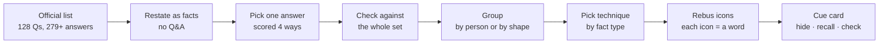

# Case Study: The Civics Facts

**Turning a static government question list into a learning system**

I became a U.S. citizen in 2024. To prepare for the civics test, I built my own way of memorizing it, and afterward shared that method with a few colleagues preparing for their own interviews. Then I turned it into an app, to challenge myself and learn the build process from end to end.

The official study material is a flat list: 128 questions on the current test, many with several accepted answers. I took it apart, rebuilt it as structured data with explicit rules, and turned it into an interactive study tool. AI tools did much of the execution. The system, the rules and the quality bar were mine.

## At a glance

| | |
|---|---|
| **279 → 111** | Accepted answers across the curated facts, reduced to one taught answer per fact: **60% less to memorize** |
| **65** | Questions where USCIS accepts more than one answer, each resolved with a scored, documented choice |
| **17** | Groupings that link related facts, so they're learned together instead of in isolation |
| **5** | Founding-figure hubs, each pulling facts from 3 different sections of the test |
| **11 / 8** | Facts flagged for respectful treatment / flagged as time-sensitive |
| **⅓** | Share of cards that relied on just 3 generic icons in the first build. Finding this drove the second version of the icon system |
| **128 → 124** | Official questions covered by 124 cards. Four pairs of questions share the same answer, so each pair is taught as one fact |
| **121 / 124** | Cards whose icon row spells out the answer. The other 3 keep a clue that already worked (a song, a word pattern, a translation) |

---

## The system

Every stage has an explicit rule, so it gives the same result whether I apply it or an AI does.

| Stage | Rule | Why |
|---|---|---|
| **Restate** | The unit is a *fact*, not a question. Several question wordings link to one fact. | You can recall a fact however it's asked. A Q&A pair only works for its own wording. |
| **Pick** | When several answers are accepted, score them on distinctiveness, how easy they are to picture, brevity and hook potential. Teach one, keep the rest on record. | Learners only need to say one answer. Studying all of them adds work, not safety. |
| **Check** | Compare each choice against every fact already curated, not just its own section. | This caught a duplicate a section-by-section review missed. |
| **Group** | *By person:* familiar figures as hubs, no limit on size. *By shape:* easily confused facts side by side, max 3–4. | New facts stick to things you already know, and confusable facts are clearer next to each other. The cap keeps cards from overloading. |
| **Technique** | A decision table maps the type of fact to a device: number badge, contrast pair, pun, timeline, metaphor or plain icon. | Not every fact deserves a gimmick. A forced pun is noise. |
| **Rebus** | Every icon stands for a word in the answer. The test: can you rebuild the fact from the icons alone? | Icons that only name the topic don't help memory. |
| **Cue card** | The fact is shown with its icon row. Toggle the text off, recall from the icons, tap to check, retire what you know. | Self-testing is there when you want it, not forced on you. |

## One fact, start to finish

**Official:** *"How many U.S. senators are there?"* Answer: *"One hundred (100)."*

1. **Restate:** "There are 100 U.S. senators."
2. **Pick:** only one answer, nothing to choose.
3. **Check:** the "2 per state" fact already exists elsewhere, so link to it instead of teaching 100 as a number on its own.
4. **Group:** "Congress by the Numbers," paired with 435 House members, two numbers about the same institution.
5. **Technique:** number badge, because the fact hinges on a number.
6. **Rebus:** **2** 🪑 × **50** 🗺 = **100**. Two seats, fifty states. The icons *derive* the answer, so you don't have to memorize it raw.
7. **Cue card:** hide the text, see "2 seats × 50 states," say "100 senators," then tap to check.

## Designed for trust

An error on a citizenship test isn't cosmetic, so trust was built into the data model from the start:

- **Two layers per card.** The fact is worded so I'd defend it to an immigration attorney. The memory hook is separate, so it can be playful without putting accuracy at risk.
- **Time-sensitive flags** on officeholder answers. The Speaker answer is expected to change in January 2027.
- **Sensitivity flags** on facts about Native American tribes, slavery, civil rights and 9/11. They get plain, respectful treatment by default.
- **Legal posture:** no official seals, a clear statement that it isn't affiliated with USCIS, every fact traceable to the official list, and no likenesses of real people.

## Directing AI: what broke and what I changed

| What happened | Root cause | What I changed |
|---|---|---|
| The first build was a well-made quiz, which was the wrong product | I never stated how it would be used, so the AI defaulted to the standard for the category | Define the interaction model before building. Rebuilt as a reread-able book; kept the first version as a record |
| Icons labeled the topic instead of cueing the answer: one scroll stood in for 18 facts | "Make it visual" was too vague | Rewrote the direction as a rule you can test: *could you rebuild the answer from the icons alone?* Then redrew the full set against it, with fixed meanings (the globe is always Secretary of State, a broken chain always means freedom) |
| A duplicate answer slipped through | Review was scoped to one section | Check every addition against the whole set |
| Visual output couldn't be rendered for review | Tooling limits | Required structural checks plus a plain statement of what wasn't verified |

**The lesson:** with AI, the leverage is in the spec and the quality gates, not in the prompt. The valuable work was writing rules precise enough to apply the same way 128 times, and checks that catch output that looks right but isn't.

## How I'd measure it

If this were taken further, these are the signals I'd use to judge whether the system works:

- **Return:** do people come back on their own, on 3 or more separate days before their interview?
- **Hook strength:** which facts keep getting re-revealed? Those hooks are weak and would be reworked first.
- **Rebus test:** with the text hidden, can someone new to the material say the fact from the icons?
- **Accuracy:** zero errors against the official list, and time-sensitive answers updated within a week of any change.

## Where it stands

The app is complete: all 128 questions are covered, and every card pairs its fact with an icon clue. The pipeline is built to absorb a test revision: USCIS has changed the test twice since 2020.
